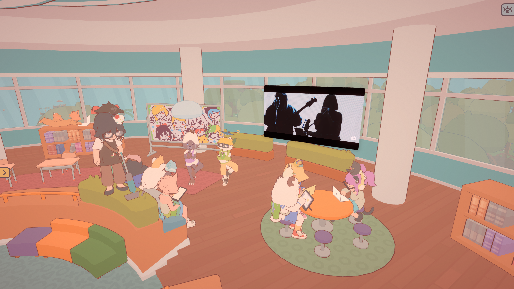
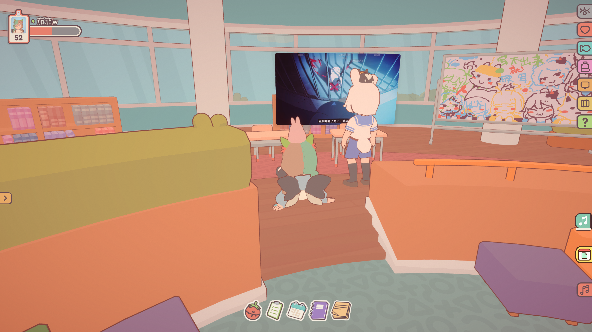

语言 / Language：[简体中文](README.md) · [English](README.en.md)

  

  <strong>On-Together 房间共享网页屏幕 Mod</strong> 
  beta1.1 · Windows / Apple Silicon Mac · @茄茄w

OT-WebScreen 可以在 On-Together 房间里放置一块网页屏幕，和你的房间成员们一起观看视频、直播和其他网页。

  

  

如果想让你的社交更有趣，可以了解 [OTMusic](https://github.com/qieqieWWW/OTMusic-Mod) 的仓库。

## 安装和使用

如果你想在mac上使用，请确保你的mac搭载Apple Silicon而非Intel芯片。

完整的安装和使用教程包含在 [Releases](https://github.com/qieqieWWW/OT-Webscreen/releases) 的发布包内。Windows 使用 BepInEx 5，Apple Silicon Mac 使用 BepInEx 6；安装器会检查并安装对应版本。

## 主要功能

- 在房间内放置、移动、旋转和缩放共享的网页屏幕，并访问网页链接。
- 使用输入模式操作网页；房间内同步网址、鼠标与键盘操作。
- 收起控制面板后继续观看；进入「灵魂出窍」模式，自由移动视角或一键前往最佳观影位置。

网页内容由每位玩家的浏览器分别加载；播放效果取决于各自的网络及站点访问状态，mod只起到同步操作的作用。
